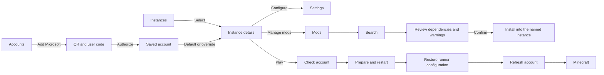

# Launcher controls, instances and accounts

## Update

Install the matching **runner 0.45 PKG** from `orbis-java-app/build-runner/output/`.
Then, with the PS4 application closed, upload the complete rebuilt graphics bundle to the
directory named by `graphics_bundle` in `/data/orbis-jdk/runner/runner.conf`, and upload its
manifest last: `graphics-probe/build/graphics-bundle-radeonsi/` to `/data/orbis-jdk/graphics-radeonsi`
(radeonsi, the active driver), and `graphics-probe/build/graphics-bundle/` to
`/data/orbis-jdk/graphics-neo` (the Zink fallback). The launcher JAR and native
platform must be from the same build; uploading only the JAR is insufficient for system
keyboard and restart support. The JDK does not need rebuilding for this update.

Keep the existing launcher entrypoint metadata, Minecraft profile, assets and libraries.
The launcher entrypoint remains `orbis.launcher.Launcher`; the installed game profile remains
`/data/orbis-jdk/minecraft-runner/version.json` unless `orbis.launcher.gameMetadata` overrides it.
Back up configuration before uploading. Do not replace an active graphics/native bundle.

## Controls

- L1/R1: switch Instances, Mods, Accounts and Settings. Keyboard: Page Up/Page Down.
- D-pad/stick: move selection. Cross/Enter: activate. Circle/Escape: back or cancel.
- Tab or Left/Right: move between a list and its details where applicable.
- Select a text field to edit it. Controller entry opens the PS4 system keyboard;
  a physical keyboard edits the field directly.
- During text entry, navigation and launcher actions are suppressed. Enter accepts once;
  Escape restores the original text. The launcher has no rendered keyboard.
- Destructive confirmations start on Cancel.
- Circle cancels a Modrinth search or a mod download and check that is still running.

Accounts page:

- Cross on an account makes it the default.
- Triangle on Offline edits the offline player name; on a Microsoft account it signs out.
- Add Microsoft account opens the sign-in dialog; Circle cancels it.
- The last row picks the selected instance's account with Left/Right or Cross:
  Follow default, Offline, or a signed-in account.

## Instances

The current installation is registered in place, preserving its files. New instances share
its installed Minecraft 1.18.2/Fabric runtime, libraries, assets and graphics bundle. Their
mods, configuration and worlds live separately under `launcher/instances/<id>/game/`.
Clone copies mods/configuration; copying worlds is an explicit option, off by default.
Removing the imported installation removes its registration only. Removing a managed
instance deletes its private files after confirmation.

Memory settings belong to each instance. Runner debug logging is a global preference.
An instance can follow the default account or explicitly select an account, including Offline.
This update does not install other Minecraft versions.

Play checks the account, journals temporary runner settings and restarts the application.
A short-lived request contains IDs only. After restart the launcher consumes the request,
restores runner files, refreshes authentication, and constructs game arguments in memory.
Failed or unrelated starts discard the request and return to the launcher. Exiting Minecraft
closes the application; reopening it normally shows the launcher.

## Minecraft versions

Instances → Create instance opens the version list. Left/Right picks the loader (Fabric, Quilt
or Vanilla); Cross on a release names the new instance, then downloads what it needs with
progress (Circle cancels; a later attempt resumes and re-checks what was already downloaded).
Releases 1.14 to 1.20.4 are offered: everything that runs on Java 17. The built-in 1.18.2 with
Fabric needs no download.

Libraries and assets are shared with the built-in installation (`/data/orbis-jdk/libraries`,
`/data/orbis-jdk/assets`), so files common to several versions download once. Each version
keeps its client JAR and profiles in `launcher/versions/<version>-<loader>-<loader version>/`.
Every version runs on the audited LWJGL 3.2.2 and the Orbis GLFW adapter (a client audit found
nothing else these releases need besides `glfwGetPlatform`, which the adapter now provides).
Play boots the chosen version's own JAR and profile once, then the runner settings are restored.

Quilt instances use Fabric mods from Modrinth (Quilt runs them; Quilt-only mods are not offered).
Vanilla instances have no mod browser. 1.14 to 1.16 render with older OpenGL through the driver's
compatibility profile and are less tested; 1.14 to 1.16 also use Mojang's current log4j
configuration, which disables the Log4Shell lookup.

## Microsoft sign-in

Copy `microsoft-auth.properties.example` to
`/data/orbis-jdk/launcher/microsoft-auth.properties` and set your approved application's
`client_id`. Configure it as a public client with personal Microsoft account support and
allow device authorization/public client flows. **No client secret is used or stored.**

Without that file, Add Microsoft account shows the instructions above instead of signing in.
The client ID must also be approved for the Minecraft services API; an unapproved ID signs in
to Microsoft and Xbox but is rejected at the Minecraft login step.

Accounts → Add Microsoft account starts device sign-in. Scan the QR or visit the displayed
Microsoft URL, then enter the displayed user code. The QR encodes the verification URL;
it does not automatically submit the code. The launcher waits at Microsoft's polling
interval and handles expiry, cancellation, ownership and account restrictions.

Profile metadata and refresh credentials are separate local files. Refresh credentials use
owner-only permissions where supported, but are not encrypted; protect console FTP access.
Access tokens stay in memory. Sign-out removes the local refresh credential. Authentication
failure never silently switches to Offline. Offline is an explicit account choice.

## Validation status

Built on the host: launcher JAR, both platform libraries, both graphics bundles, and the
0.45 runner PKG. The host test (`graphics-probe/tests/test_launcher.py`) drives the real
launcher screen with random input across every page, including Play: each prepared launch is
consumed as the next start would, and a failed restart restores runner.conf and jvm-options.
This new workflow still needs console validation: controller navigation and held-button
release, system keyboard submit/cancel/reopen, physical keyboard, create/clone isolation,
mod install/cancel, QR sign-in/refresh, selected-instance Play, and recovery after a failed
restart. Also check that the PS4 passes the launch argument through the restart: if not,
`/data/orbis-jdk/launcher/launcher.log` shows `launcher: no launch intent argument`, and the launcher accepts
only a launch prepared in the last 30 seconds. A successful build does not establish these
hardware behaviors.

## Workflow

